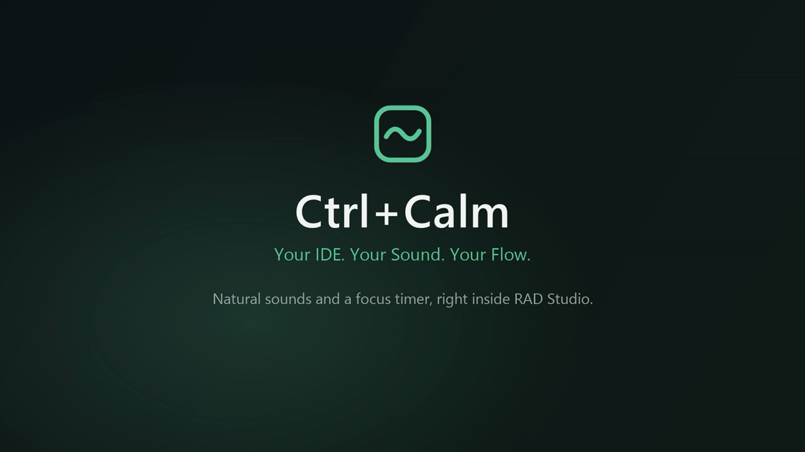
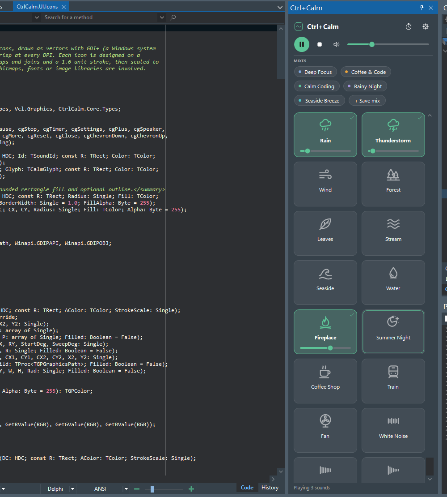
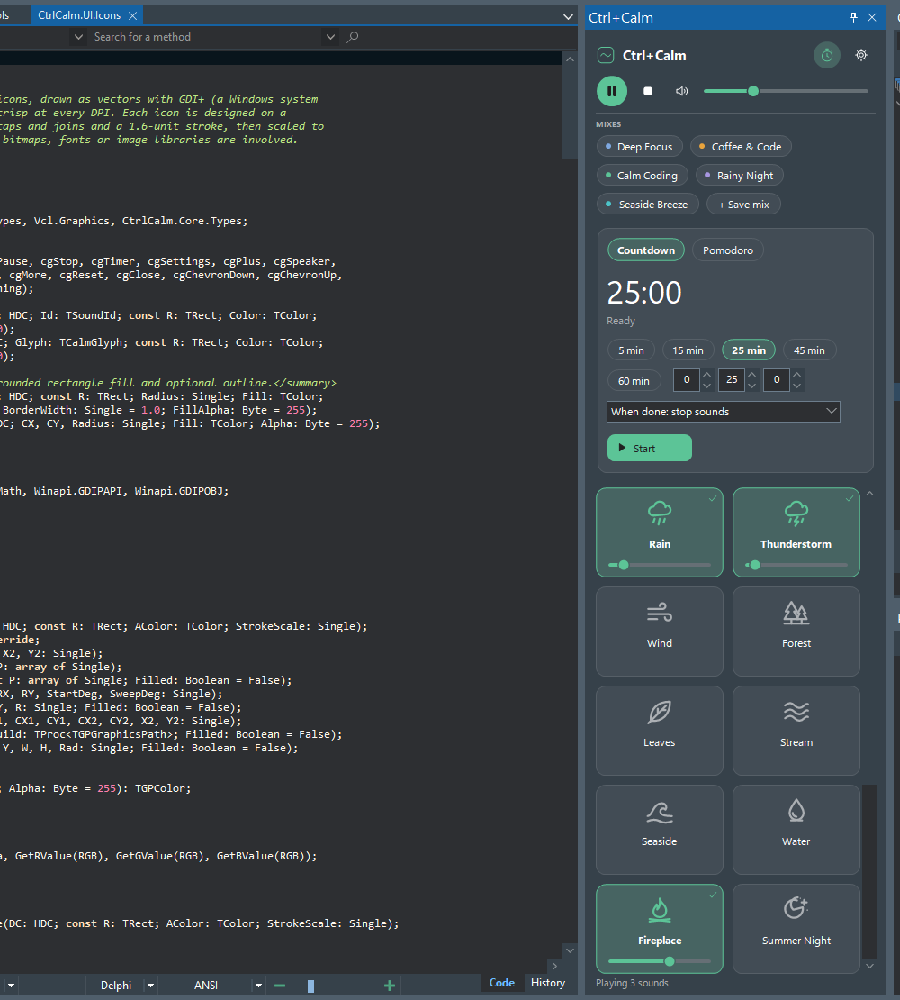
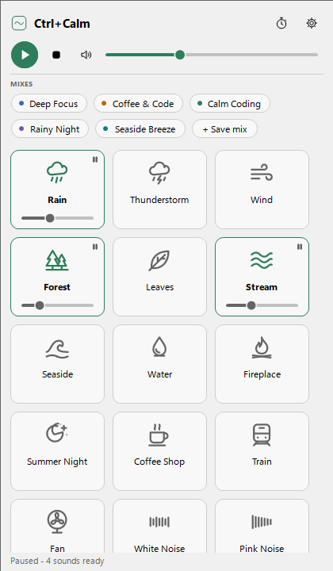
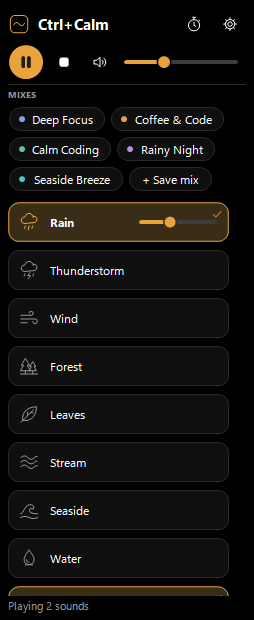
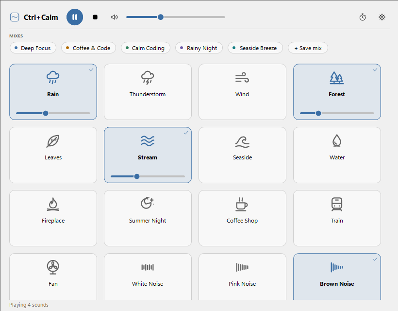

# Ctrl+Calm

**Your IDE. Your Sound. Your Flow.**

Deep focus is hard to keep in a busy day. Natural sound helps: steady rain, a crackling
fire or a forest full of birdsong calm the mind, mask distractions and make it easier to
settle into deep work.

Ctrl+Calm brings that calm into Embarcadero RAD Studio. It is an offline nature-sound mixer
and focus timer that lives in the IDE as a native, dockable tool window. Mix rain, wind,
a fireplace, a forest, a coffee shop and eleven more sounds, start a focus timer, then hide
the panel and keep coding while it plays.

It is written in Delphi with VCL, the Open Tools API and Windows' own XAudio2. It needs no
account, makes no network requests and has no runtime dependencies beyond RAD Studio and
Windows.

## Video

<p align="center">
  <a href="https://youtu.be/7n-7VCJk2tc">
    
  </a>
  <br />
  <sub>Watch the Ctrl+Calm video on YouTube: <a href="https://youtu.be/7n-7VCJk2tc">https://youtu.be/7n-7VCJk2tc</a></sub>
</p>

## Screenshots




| Light theme | Compact layout | Wide layout |
|---|---|---|
|  |  |  |

## Features

- **16 sounds:** Rain, Thunderstorm, Wind, Forest, Leaves, Stream, Seaside, Water,
  Fireplace, Summer Night, Coffee Shop, Train, Fan (CC0 recordings) and White, Pink and
  Brown Noise (generated in real time).
- **Real mixing:** every sound has its own level, plus master volume, mute, play/pause and
  stop all, smooth fades, seamless loops and automatic headroom so many sounds never clip.
- **Mixes:** five built-in presets (Deep Focus, Coffee & Code, Calm Coding, Rainy Night,
  Seaside Breeze) and unlimited favorites that can be saved, renamed, updated, duplicated
  and deleted. Switching mixes crossfades, and unchanged sounds keep playing.
- **Focus timer:** 5/15/25/45/60-minute presets or any duration up to 23:59:59, with pause,
  resume, reset and cancel. When the time is up, sounds stop, fade out or keep playing,
  with a desktop notification and an optional soft chime.
- **Pomodoro:** focus, short and long breaks (25/5/15 min, long break every 4 sessions, all
  configurable), optional auto-start and a different mix for focus and breaks.
- **IDE native:** a Tools > Ctrl+Calm menu built from IDE actions, and a dockable tool window
  that docks, floats and restores with the desktop layout, follows the IDE theme (light,
  dark, custom, high contrast) and is per-monitor DPI aware.
- **Polite by default:** starts silent at 30 % master volume, restores the last mix without
  playing it, and can optionally pause or mute when RAD Studio loses focus.
- **Independent per IDE:** each RAD Studio process has its own engine and timer.

## Requirements

- Windows 10 or 11 (XAudio2 2.9 is part of Windows).
- RAD Studio 13 Florence, 32-bit and/or 64-bit IDE (tested). RAD Studio 11 and 12 use the
  same APIs but are untested, see [INSTALLATION.md](docs/INSTALLATION.md#other-versions).

## Install

### From RAD Studio

1. Open `packages\RADStudio13\CtrlCalm.dproj` in RAD Studio.
2. Select the platform that matches the running IDE: **Windows 32-bit** for the 32-bit IDE
   or **Windows 64-bit** for the 64-bit IDE. A 32-bit IDE cannot load a 64-bit package and
   vice versa.
3. Select the **Release** configuration.
4. In the Projects window, right-click **CtrlCalm370.bpl** and choose **Install**.
5. Open **Tools > Ctrl+Calm > Show/Hide Mixer**.

When the package is built inside this repository, it finds the bundled sounds in
`assets\sounds` automatically.

### With PowerShell

Close RAD Studio and run:

```powershell
.\scripts\package\Install.ps1
```

The script builds the package for both IDE bitnesses, copies it with the sounds to
`%LOCALAPPDATA%\CtrlCalm\RAD13` and registers it for the current user. It needs no admin
rights and writes nothing to the RAD Studio folder. More options are described in
[docs/INSTALLATION.md](docs/INSTALLATION.md).

## Quick start

1. **Tools > Ctrl+Calm > Show/Hide Mixer.** Dock the panel anywhere.
2. Click a sound to start it, and drag its bar to set its level. Click again to stop it.
3. Pick a mix chip, or build a mix and click **+ Save mix**.
4. Click the stopwatch for the timer, choose a duration and **Start**.
5. Close the panel. Sounds and the timer keep going, and **Tools > Ctrl+Calm > Pause**
   stops them from anywhere.

## Keyboard

No shortcut is assigned by default, so Ctrl+Calm never takes keys from the editor.
Shortcuts for Show/hide, Play/pause, Mute and Timer can be assigned in
**Settings > General**, and they work like any other IDE action shortcut. Inside the panel,
Tab moves between controls, Space/Enter toggles a sound and the arrow keys change its level
(Shift for larger steps).

## Offline and private

Everything is local: sounds ship with the package, and settings and favorites are a JSON
file in `%APPDATA%\CtrlCalm`. Ctrl+Calm contains no networking code, telemetry or
activation.

## Sound licensing

The 13 recordings are by Joseph Sardin, published on [BigSoundBank.com](https://bigsoundbank.com)
under [CC0 1.0](https://creativecommons.org/publicdomain/zero/1.0/). Per-file source URLs,
original checksums, processing notes and bundled checksums are in
[assets/sounds/manifest.json](assets/sounds/manifest.json), see also
[assets/ATTRIBUTION.md](assets/ATTRIBUTION.md) and [assets/LICENSES.md](assets/LICENSES.md).
The noise sounds are generated by Ctrl+Calm's code. The code is MIT licensed
([LICENSE](LICENSE)).

## Uninstall

### From RAD Studio

1. Open **Component > Install Packages**.
2. Select **Ctrl+Calm - ambient sounds and focus timer** and click **Remove**.
3. Restart RAD Studio.

Settings and favorites stay in `%APPDATA%\CtrlCalm` until that folder is deleted.

### With PowerShell

Close RAD Studio and run:

```powershell
.\scripts\package\Uninstall.ps1                  # keeps settings and favorites
.\scripts\package\Uninstall.ps1 -RemoveSettings  # removes them too
```

## Known limitations

- Developed and tested with RAD Studio 13 Florence on Windows 11, RAD Studio 11 and 12 are
  untested.
- Fireplace and Water are noticeably quieter than the other sounds (sparse, impulsive
  recordings), so their level needs to be set higher.
- Recorded loops are 60 seconds (Fan: 9 s) to keep the package around 133 MB, so very
  attentive listeners may notice repetition in event-rich sounds such as Forest.
- Time spent in Windows sleep counts toward the timer (it is wall-clock based by design).
- Theme changes, docking layouts, sleep/resume, device unplugging and multi-monitor DPI are
  covered by the manual checklist in [docs/TESTING.md](docs/TESTING.md), not by automated
  tests.

## Documentation

[Architecture](docs/ARCHITECTURE.md) · [Audio engine](docs/AUDIO_ENGINE.md) ·
[Threading](docs/THREADING.md) · [UI guidelines](docs/UI_GUIDELINES.md) ·
[Installation](docs/INSTALLATION.md) · [Testing](docs/TESTING.md) ·
[Troubleshooting](docs/TROUBLESHOOTING.md) · [Contributing](CONTRIBUTING.md)
